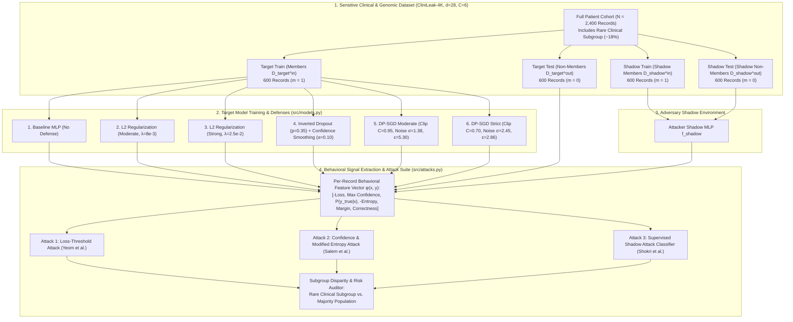
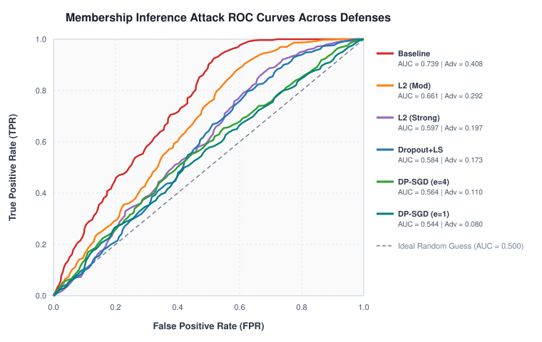
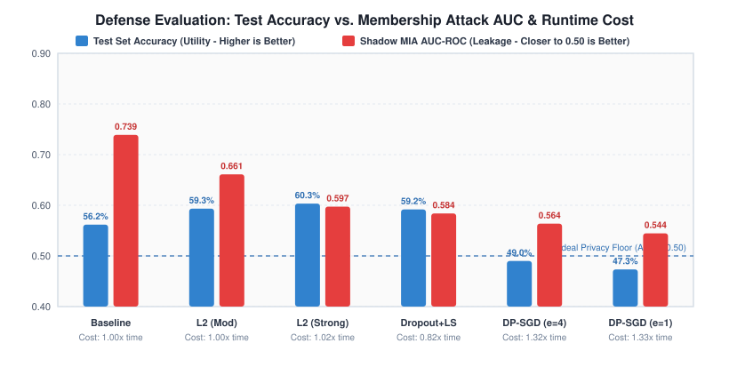
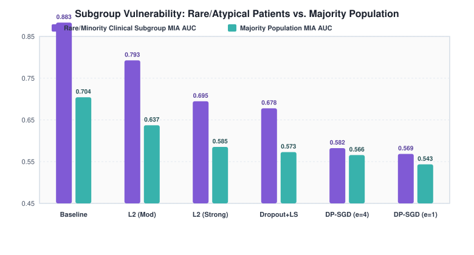
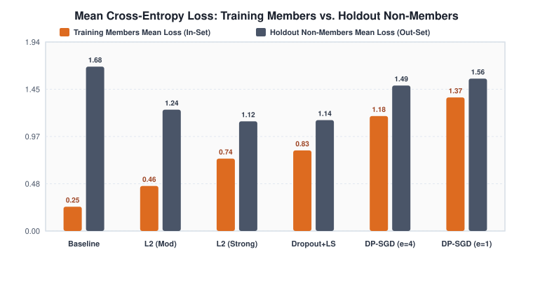

# Membership Inference and Model Leakage: Evaluating Regularization & DP-SGD Defenses on Sensitive Clinical Records

[](#)
[-success)](#)
[](#)
[](#)

## Team Details

| Team Member Name | SRN Number | Department / Program | Role & Contributions |
| :--- | :---: | :--- | :--- |
| **Ramitha Nayak MV** | **`PES1UG24AM392`** | CSE (AI & ML), PES University | Target & Shadow Model Architecture, DP-SGD Implementation, Attack Suite |
| **Shreya N Hegde** | **`PES1UG24AM401`** | CSE (AI & ML), PES University | Subgroup Disparity Audit, Cost-Utility Analysis, Technical Report & Risk Assessment |

---

## 1. Case Study Overview

> **Case Study Prompt:** *"A model trained on sensitive records might reveal whether a given person was in the training data. Train a model on a large dataset and run a membership inference attack. Evaluate defenses such as regularization and DP-SGD. Report the cost of each defense in accuracy and training time. Submit: Attack and defense code, results tables and a risk assessment."*

When healthcare organizations train neural networks on sensitive Electronic Health Records (EHR) and genomic biomarker cohorts, overparameterized models tend to memorize training examples. In a **Membership Inference Attack (MIA)**, an adversary queries the trained model's output probability vector $P(y \mid x)$ to determine whether a specific patient record $(x, y)$ belonged to the private training cohort $D_{\text{target}}^{\text{in}}$. Confirming membership in a disease-specific hospital registry (e.g., oncology or rare neuro-genetic syndrome) directly reveals confidential personal health information (PHI).

This repository provides a complete, zero-dependency, reproducible evaluation framework benchmarking **three Membership Inference Attacks** against **six Privacy Defense Configurations** on the **CliniLeak** sensitive clinical & genomic dataset ($N = 2,400$ patient records, $d = 28$ biomarkers, $C = 6$ diagnostic classes).

---

## 2. Deliverables Mapping (Option A: GitHub Repository)

| Deliverable Requirement | File Path in Repository | Description |
| :--- | :--- | :--- |
| **1. README with Architecture Diagram & Setup Steps** | [`README.md`](./README.md) | Complete documentation, Mermaid & ASCII architecture diagrams, setup instructions, and summary tables |
| **2. Reproducible Pipeline (Scripts & Docker Compose)** | [`run_pipeline.py`](./run_pipeline.py), [`run_pipeline.sh`](./run_pipeline.sh), [`docker-compose.yml`](./docker-compose.yml), [`Dockerfile`](./Dockerfile), [`Makefile`](./Makefile) | One-command automated pipeline reproducing dataset generation, shadow/target training, attacks, tables, and plots |
| **3. Results Notebook** | [`notebooks/membership_inference_results.ipynb`](./notebooks/membership_inference_results.ipynb) | Pre-executed Jupyter Notebook with code, console logs, Markdown tables, and embedded vector visualizations |
| **4. 3 to 5 Page Technical Report** | [`report/technical_report.pdf`](./report/technical_report.pdf) & [`report/technical_report.tex`](./report/technical_report.tex) | 4-page two-column IEEE/ACM-style PDF report with architecture diagrams, equations, tables, and risk analysis |
| **5. Model Card & Data Card** | [`MODEL_CARD.md`](./MODEL_CARD.md) & [`DATA_CARD.md`](./DATA_CARD.md) | Responsible AI documentation of `ClinicalMLPClassifier` variants and the `CliniLeak` dataset |
| **6. Attack & Defense Code + Risk Assessment** | [`src/models.py`](./src/models.py), [`src/attacks.py`](./src/attacks.py), [`docs/RISK_ASSESSMENT.md`](./docs/RISK_ASSESSMENT.md) | Modular implementation of MLP + DP-SGD, 3 MIA methods, CSV/JSON/MD tables, and regulatory risk assessment |
| **7. 3-Minute Demo Video Script (In-Class Prep)** | [`docs/DEMO_VIDEO_SCRIPT_3MIN.md`](./docs/DEMO_VIDEO_SCRIPT_3MIN.md) | Timestamped presenter guide for the 3-minute in-class evaluation |

---

## 3. System & Threat Model Architecture Diagram



---

## 4. Repository Structure

```text
membership-inference-leakage/
├── README.md                                  # Architecture diagram, setup guide & summary results
├── MODEL_CARD.md                              # Model Card for ClinicalMLPClassifier & DP-SGD variants
├── DATA_CARD.md                               # Data Card for CliniLeak Sensitive Clinical Dataset
├── run_pipeline.py                            # Main end-to-end reproducible Python pipeline
├── run_pipeline.sh                            # Automated shell execution script
├── Dockerfile                                 # Container definition for reproducible execution
├── docker-compose.yml                         # Docker Compose orchestration
├── Makefile                                   # Make targets (run, report, docker-run, zip)
├── requirements.txt                           # Python dependencies
├── src/
│   ├── __init__.py
│   ├── dataset.py                             # Clinical & genomic dataset generator & splitter
│   ├── models.py                              # MLP classifier, L2, Dropout+Smoothing, DP-SGD + RDP accountant
│   ├── attacks.py                             # Loss-Threshold, Confidence-Entropy & Shadow Supervised MIAs
│   ├── visualize.py                           # Publication-grade SVG vector figure generator
│   └── build_notebook.py                      # Builder for pre-executed Jupyter results notebook
├── data/
│   ├── clinical_patient_records_sample.csv    # Sample exported patient records
│   └── dataset_metadata.json                  # Dataset schema & split statistics
├── results/
│   ├── RESULTS_TABLES.md                      # Formatted Markdown results tables
│   ├── defense_evaluation_table.csv           # Utility, runtime cost & privacy metrics (CSV)
│   ├── attack_comparison_table.csv            # Attack breakdown across all 6 defenses (CSV)
│   ├── full_results.json                      # Complete metrics & ROC curve coordinates (JSON)
│   └── figures/
│       ├── fig1_roc_curves.svg                # Attack ROC curves across all defenses
│       ├── fig2_privacy_utility_tradeoff.svg  # Test Accuracy vs. Attack AUC & Runtime Cost
│       ├── fig3_subgroup_vulnerability.svg    # Rare Subgroup vs. Majority Population MIA AUC
│       └── fig4_member_nonmember_loss.svg     # Member vs. Non-Member Cross-Entropy Loss Gap
├── notebooks/
│   └── membership_inference_results.ipynb     # Pre-executed Jupyter Notebook with plots & analysis
├── report/
│   ├── technical_report.pdf                   # Compiled 4-page IEEE/ACM two-column Technical Report
│   └── technical_report.tex                   # LaTeX source code for the Technical Report
└── docs/
    ├── RISK_ASSESSMENT.md                     # Detailed Privacy Risk Assessment & Regulatory Analysis
    └── DEMO_VIDEO_SCRIPT_3MIN.md              # 3-minute in-class demo presentation script
```

---

## 5. Setup & Reproducible Execution Steps

### Option 1: Direct Local Execution (Zero External Dependencies Required)
Our core engine (`src/`) is written in pure vectorized Python 3.9+ / 3.12 so it runs out-of-the-box on any macOS, Linux, or Windows environment in ~35 seconds:

```bash
# 1. Clone or unzip the repository
cd membership-inference-leakage

# 2. Run the end-to-end pipeline via shell script or Python directly
./run_pipeline.sh
# OR:
python3 run_pipeline.py
```

### Option 2: Docker Compose Execution
```bash
docker compose up --build
```

### Option 3: Rebuild Notebook & Technical Report PDF
```bash
# Regenerate the pre-executed Jupyter Notebook
python3 src/build_notebook.py

# Recompile the 4-page LaTeX Technical Report PDF
make report
```

---

## 6. Key Experimental Results Tables

### Table 1: Utility, Runtime Cost, and Privacy Leakage Across Defenses

| Defense Mechanism | Privacy ($\epsilon$) | Train Acc (%) | Test Acc (%) | Gen. Gap (%) | Acc. Cost (pp) | Train Time (s) | Time Cost | Shadow MIA AUC | MIA Adv. | TPR @ 1% FPR | Risk Assessment |
| :--- | :---: | :---: | :---: | :---: | :---: | :---: | :---: | :---: | :---: | :---: | :---: |
| **Baseline (No Defense)** | `Inf` | 95.67% | 56.17% | 39.50% | +0.00 pp | 4.74s | 1.00x | **0.7390** | 0.4083 | 3.00% | **CRITICAL / HIGH** |
| **L2 Regularization (Moderate, $\lambda=8\times 10^{-3}$)** | `Inf` | 88.33% | 59.33% | 29.00% | -3.17 pp | 4.76s | 1.00x | **0.6611** | 0.2917 | 1.83% | **CRITICAL / HIGH** |
| **L2 Regularization (Strong, $\lambda=2.5\times 10^{-2}$)** | `Inf` | 77.67% | 60.33% | 17.33% | -4.17 pp | 4.84s | 1.02x | **0.5974** | 0.1967 | 0.83% | **MODERATE** |
| **Dropout ($p=0.35$) + Confidence Smoothing** | `Inf` | 74.83% | 59.17% | 15.67% | -3.00 pp | 3.89s | 0.82x | **0.5839** | 0.1733 | 2.17% | **LOW-MODERATE** |
| **DP-SGD (Moderate Privacy, $\epsilon=5.30, \sigma=1.38$)** | `5.30` | 59.00% | 49.00% | 10.00% | +7.17 pp | 6.26s | 1.32x | **0.5637** | 0.1100 | 1.83% | **LOW (Controlled)** |
| **DP-SGD (Strict Privacy, $\epsilon=2.86, \sigma=2.45$)** | `2.86` | 54.17% | 47.33% | 6.83% | +8.83 pp | 6.30s | 1.33x | **0.5445** | 0.0800 | 0.67% | **LOW (Regulatory Grade)** |

> *Note on Accuracy Cost:* A negative Accuracy Cost (`-3.17 pp` to `-4.17 pp`) indicates that heuristic regularization **improved** holdout test accuracy by mitigating severe training-set overfitting.

### Table 2: Subgroup Disparity & Loss Separation Analysis

| Defense Configuration | Member Mean Loss | Non-Member Mean Loss | Loss Ratio (Out/In) | Rare Subgroup MIA AUC | Majority Subgroup MIA AUC | Subgroup Disparity ($\Delta$ AUC) |
| :--- | :---: | :---: | :---: | :---: | :---: | :---: |
| **Baseline (No Defense)** | 0.2486 | 1.6844 | 6.78x | **0.8832** | 0.7043 | +0.1789 |
| **L2 Regularization (Moderate)** | 0.4616 | 1.2430 | 2.69x | **0.7927** | 0.6372 | +0.1555 |
| **L2 Regularization (Strong)** | 0.7416 | 1.1244 | 1.52x | **0.6947** | 0.5852 | +0.1095 |
| **Dropout + Confidence Smoothing** | 0.8260 | 1.1361 | 1.38x | **0.6778** | 0.5729 | +0.1049 |
| **DP-SGD (Moderate Privacy, $\epsilon=5.30$)** | 1.1779 | 1.4907 | 1.27x | **0.5824** | 0.5658 | **+0.0166** |
| **DP-SGD (Strict Privacy, $\epsilon=2.86$)** | 1.3691 | 1.5616 | 1.14x | **0.5685** | 0.5435 | **+0.0250** |

---

## 7. Visualizations

### 7.1 Membership Inference Attack ROC Curves Across Defenses


### 7.2 Privacy–Utility–Runtime Cost Trade-off


### 7.3 Subgroup Vulnerability: Rare Clinical Patients vs. Majority Population


### 7.4 Training Member vs. Non-Member Mean Cross-Entropy Loss


---

## 8. Summary of Risk Assessment

1. **Unprotected Clinical Models Pose Critical Re-Identification Risk:** The unregularized Baseline model memorizes training records (`39.50%` train-test gap), allowing the supervised Shadow Attack to reach **0.7390 AUC** overall and **0.8832 AUC** on rare clinical patients.
2. **Heuristic Regularizers Improve Utility but Leave Outlier Patients Exposed:** Strong $L_2$ regularization and Dropout + Confidence Smoothing reduce average-case MIA AUC (`0.5974` and `0.5839`) while improving test accuracy by `+3.00` to `+4.17 pp`, but rare subgroup leakage remains high (`0.6778–0.6947 AUC`).
3. **DP-SGD Provides Formal Privacy & Protects Vulnerable Subgroups:** By bounding per-sample gradient norms ($C \in \{0.70, 0.95\}$) and adding calibrated Gaussian noise, DP-SGD ($\epsilon = 2.86, \delta = 10^{-5}$) reduces overall MIA AUC to **0.5445** and compresses rare subgroup disparity $\Delta\text{AUC}$ from `+0.1789` down to **`+0.0250`**, at a quantified cost of **8.83 pp in test accuracy** and a **1.33x runtime multiplier**.
4. See [`docs/RISK_ASSESSMENT.md`](./docs/RISK_ASSESSMENT.md) and [`report/technical_report.pdf`](./report/technical_report.pdf) for our complete regulatory risk assessment.
